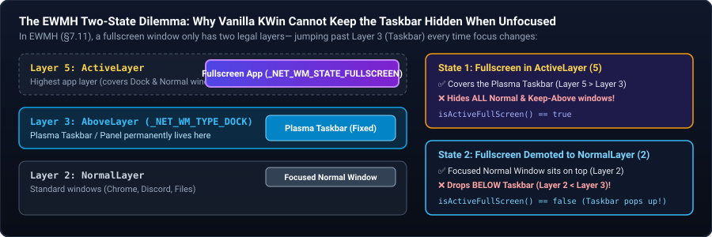
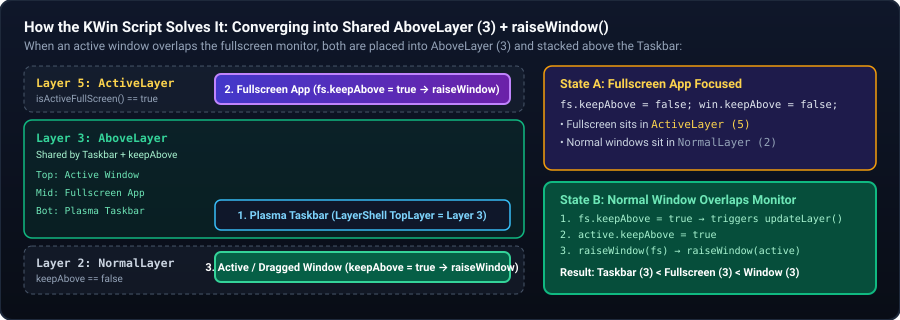

# Windows 11 Fullscreen Stacking for KDE Plasma 6 (KWin Script)

A lightweight KWin Script for **KDE Plasma 6** that makes fullscreen applications behave the way they do in **Windows 11**—especially on multi-monitor setups.

With this script enabled:
1. **Fullscreen apps cover the Plasma Taskbar (Panel):** When a fullscreen app is focused—or when it is sitting on a secondary monitor while you work elsewhere—it covers the taskbar on its monitor.
2. **Dragged and focused windows render *above* fullscreen apps:** When you drag a normal window from another monitor onto a fullscreen app (or focus a normal window on the same screen), the normal window smoothly renders **on top of** the fullscreen app, while the fullscreen app **continues to cover the taskbar underneath**.
3. **Clicking the fullscreen app restores it to the front:** Focusing the fullscreen app again immediately sends overlapping normal windows behind it.
4. **Pressing the Meta (Windows) key works naturally:** Opening the Application Launcher on the fullscreen monitor temporarily allows the launcher and taskbar to appear above the fullscreen app until you click back into your app.

---

*The following is an analysis written by an autonomous agent*

## The Problem This Script Solves

On Windows 11, fullscreen windows participate naturally in desktop Z-ordering:
- A fullscreen video, browser (`F11`), or game covers the taskbar on that monitor.
- If you drag a smaller window (e.g., Discord, a calculator, notes, or a file manager) from Monitor B onto the fullscreen app on Monitor A, **the window you are dragging stays on top of the fullscreen app**, and the fullscreen app stays on top of the taskbar.

On **KDE Plasma (KWin)**, trying to do this out of the box hits two frustrating issues:

### 1. Default KWin Behavior: Dragged Windows Disappear Underneath Fullscreen Apps
By default in KWin, if you have a fullscreen application on Monitor A and drag a normal window from Monitor B across the screen boundary onto Monitor A, **the dragged window vanishes underneath the fullscreen app**. Even after releasing the mouse button, the fullscreen app often remains locked in KWin's topmost `ActiveLayer`, hiding the active window you just dragged over it.

### 2. Why the Standard "Window Rule" Workaround Breaks Your Taskbar
If you search Reddit, the KDE Forums, or KDE Bugzilla for how to allow windows on top of fullscreen apps, the universally repeated advice is to create a KWin **Window Rule** forcing `Layer = Normal` for normal windows (or `Layer = On Screen Display` for specific apps).

However, in KWin's layer architecture:
- **`NormalLayer` (`Layer 2`) sits strictly *below* the Plasma Taskbar (`AboveLayer` / `Dock`, `Layer 3`).**
- Because KWin Window Rules are static and cannot filter by whether a window is currently focused or unfocused, forcing `Layer = Normal` demotes *all* fullscreen windows—including **actively focused** ones—below the Plasma Taskbar.
- As a result, **your taskbar permanently overlays on top of your fullscreen videos and games**.

### Behavior Comparison

| Scenario | Default KWin 6 | Static Window Rule (`Layer = Normal`) | **This KWin Script (Windows 11 Behavior)** |
| :--- | :---: | :---: | :---: |
| Focused fullscreen app covers the Taskbar | Yes | **No** (Taskbar overlays fullscreen app) | **Yes** |
| Unfocused fullscreen app on Monitor A covers Taskbar while working on Monitor B | Yes | **No** | **Yes** |
| Dragging a window from Monitor B onto a fullscreen app on Monitor A renders the dragged window on top | **No** (Window hides behind fullscreen app) | Yes | **Yes** |
| Taskbar stays hidden beneath the fullscreen app while a smaller window sits on top of the fullscreen app | **No** (Taskbar pops up over fullscreen app) | **No** (Taskbar is always on top) | **Yes** |
| Pressing `Meta` (Super) brings up the Application Launcher & Taskbar | Yes | Yes | **Yes** |

### Visual Comparison & Interactive Simulator

[](https://covarianttensor.github.io/kwin-win11-fullscreen-stacking/)

> **[▶ Launch the Interactive Drag-and-Drop Simulator (GitHub Pages)](https://covarianttensor.github.io/kwin-win11-fullscreen-stacking/)** — Drag the Chrome window across the monitor boundary yourself and toggle between **Actual KWin 6.8 (`<50%` Bug)**, **Intended EWMH (No Bug)**, and **Our Windows 11 Script** with live EWMH §7.11 specification citations.

---

## Installation

### Option 1: Automatic Install Script (Recommended)
Clone this repository and run `./install.sh`, which installs the script into `~/.local/share/kwin/scripts/win11-fullscreen-stacking`, enables it in `kwinrc`, and reloads KWin immediately via D-Bus (no logout required):

```bash
git clone https://github.com/covarianttensor/kwin-win11-fullscreen-stacking.git
cd kwin-win11-fullscreen-stacking
./install.sh
```

To uninstall and restore default KWin behavior:
```bash
./uninstall.sh
```

### Option 2: Using `kpackagetool6`
```bash
kpackagetool6 --type=KWin/Script -i .
kwriteconfig6 --file kwinrc --group Plugins --key win11-fullscreen-stackingEnabled true
qdbus6 org.kde.KWin /KWin reconfigure
```

> **Important:** Make sure you remove any static KWin Window Rules that force `Layer = Normal` on Normal Windows (`System Settings → Window Management → Window Rules`), as static rules override KWin's dynamic layer calculation.

---

# Exhaustive Technical Deep-Dive: Why This Happens & How We Solved It

Despite this being one of the most common multi-monitor complaints from users migrating from Windows to KDE Plasma, no existing KWin script solved it. Below is a complete technical breakdown of the specifications, community misconceptions, developer discussions, and KWin's C++ stacking engine (`src/window.cpp`, `src/activation.cpp`, `src/layershellv1window.cpp`, and `src/layers.cpp`) that led to this solution.

---

## 1. Developer Stance & The EWMH Specification

Historically, KWin's window stacking engine was designed around the X11 **Extended Window Manager Hints (EWMH / NetWM)** specification ([Stacking Order section](https://specifications.freedesktop.org/wm-spec/latest/ar01s07.html#STACKINGORDER)), which defines a strict layered hierarchy:
1. `_NET_WM_TYPE_DESKTOP`
2. `_NET_WM_STATE_BELOW`
3. Normal windows (with no state or type hint)
4. `_NET_WM_TYPE_DOCK` (Panels / Taskbars) and `_NET_WM_STATE_ABOVE`
5. **Focused `_NET_WM_STATE_FULLSCREEN` windows**

When users report on KDE Bugzilla that "Keep Above" windows or windows dragged from another monitor are hidden underneath fullscreen applications, KWin developers have historically cited EWMH compliance:
- **KDE Bug [#296076](https://bugs.kde.org/show_bug.cgi?id=296076)** & **KDE Bug [#437139](https://bugs.kde.org/show_bug.cgi?id=437139):** Discussions around fullscreen windows occupying `ActiveLayer` and how multi-monitor focus affects panels, popups, and other windows.
- **KDE Invent [MR !1957](https://invent.kde.org/plasma/kwin/-/merge_requests/1957):** Upstream KWin refactoring around `Window::isActiveFullScreen()` and `isOnOutput()` to decide when a fullscreen window on one monitor should remain in `ActiveLayer` while another monitor has focus.

Because EWMH dictates that active fullscreen windows live in a layer above `_NET_WM_TYPE_DOCK` and `_NET_WM_STATE_ABOVE`, and that unfocusing a fullscreen window on the same screen drops it all the way back to the Normal layer (below `_NET_WM_TYPE_DOCK`), KWin's native state machine only has two states for a fullscreen window:
1. **`ActiveLayer` (`Layer 5`):** Covers the taskbar, **and** covers every normal/Keep-Above window on that screen.
2. **`NormalLayer` (`Layer 2`):** Allows normal windows on top of it, **but** drops below the taskbar (`Layer 3`), causing the Plasma Panel to pop up over the fullscreen app.

There is no native third state in KWin's state machine where a fullscreen window sits **above the taskbar** while a normal window sits **above the fullscreen window**:



---

## 2. Community Misunderstandings & Why Existing Workarounds Hit a Wall

Across recurring threads on Reddit and KDE forums—such as:
- [*"How can I make Plasma fullscreen windows not be always on top?"* (`discuss.kde.org`)](https://discuss.kde.org/t/how-can-i-make-plasma-fullscreen-windows-not-be-allways-on-top/28491)
- [*"Is it possible to keep a window above a full screen window?"* (`r/kde`)](https://www.reddit.com/r/kde/comments/z0zptp/is_it_possible_to_keep_a_window_above_a_full/)
- [*"Please how to keep window above fullscreen?"* (`r/kde`)](https://www.reddit.com/r/kde/comments/1rgi7l4/please_how_to_keep_window_above_fullscreen/)
- [*"'Always on Top' windows ignored if an app is fullscreen"* (`r/kde`)](https://www.reddit.com/r/kde/comments/qq5ojw/always_on_top_windows_ignored_if_an_app_is/)
- [*"PiP Always on Top on KDE"* (Medium)](https://medium.com/@80h3m14n/pip-always-on-top-on-kde-e79061a881f4)

three major misconceptions prevented the community from building a proper fix:

### Misconception 1: *"Just use a global Window Rule to force `Layer = Normal`"*
Users discover that KWin Window Rules (`kwinrulesrc`) expose a `Layer` property. Setting `Window types: Normal Window` → `Layer: Force Normal` stops fullscreen apps from entering `ActiveLayer`. However:
- Window Rules in KWin are **stateless** with respect to focus: there is no matching predicate for *"is unfocused"* or *"another window is overlapping this monitor"*.
- Forcing `Layer = Normal` applies even when the fullscreen app is focused, placing it in `NormalLayer` (`2`) underneath the Plasma Panel in `AboveLayer` (`3`).

### Misconception 2: *"Just enable 'Keep Above Others' (`Alt+F3`) on the window you're dragging"*
In Windows, setting a window to "Always on Top" (`HWND_TOPMOST`) allows it to appear over borderless fullscreen windows. In KWin, "Keep Above" places a window in `AboveLayer` (`3`), whereas a fullscreen window on a secondary monitor (or during a cross-monitor drag) is placed in `ActiveLayer` (`5`). Because `5 > 3`, `ActiveLayer` unconditionally occludes `AboveLayer`.

### Misconception 3: *"A KWin Script cannot fix this because `window.layer` is read-only"*
If you check KWin's Scripting API documentation, `KWin::Window::layer` is exposed as a **read-only** QML/JS property (`Q_PROPERTY(KWin::Layer layer READ layer)`). There is no `window.layer = ...` setter in JavaScript. Script authors who looked at the API documentation concluded that KWin Scripts cannot manipulate window layers and gave up—assuming only static C++ Window Rules (`RuleBook`) could alter layers.

---

## 3. Inside KWin's C++ Stacking Engine (`invent.kde.org/plasma/kwin`, Plasma 6.8)

Inspecting KWin's upstream C++ source code in [`plasma/kwin`](https://invent.kde.org/plasma/kwin/-/tree/Plasma/6.8) reveals **five key implementation details** that explain how KWin's multi-monitor fullscreen stacking works under the hood and how a KWin Script can achieve Windows 11 stacking without needing write access to `window.layer`.

---

### Finding #1: KWin's 10-Layer Enum & `Window::belongsToLayer()` ([`src/window.cpp`](https://invent.kde.org/plasma/kwin/-/blob/Plasma/6.8/src/window.cpp))

KWin defines 10 stacking layers in `KWin::Layer` ([`src/effect/globals.h`](https://invent.kde.org/plasma/kwin/-/blob/Plasma/6.8/src/effect/globals.h)):

| Enum Value | Name | Typical Contents |
| :---: | :--- | :--- |
| `0` | `DesktopLayer` | Desktop wallpaper / desktop view (`NET::Desktop`) |
| `1` | `BelowLayer` | Windows with `keepBelow = true` or Wayland layer-shell `BOTTOM` |
| `2` | `NormalLayer` | Standard application windows (`NET::Normal`) |
| `3` | `AboveLayer` | **Plasma Panels (`NET::Dock` / Wayland layer-shell `TOP`) AND windows with `keepAbove = true`** |
| `4` | `NotificationLayer` | Desktop notifications (`NET::Notification`) |
| `5` | `ActiveLayer` | **Active fullscreen windows (`isActiveFullScreen() == true`)** |
| `6` | `PopupLayer` | Context menus, dropdowns, popups |
| `7` | `CriticalNotificationLayer` | Critical notifications (`NET::CriticalNotification`) |
| `8` | `OnScreenDisplayLayer` | Volume/brightness OSD (`NET::OnScreenDisplay`) |
| `9` | `OverlayLayer` | Lock screen overlays, Wayland layer-shell `OVERLAY` |

In [`Window::belongsToLayer() const`](https://invent.kde.org/plasma/kwin/-/blob/Plasma/6.8/src/window.cpp#L544-593), after handling special window types (unmanaged windows, lock screen overlays, desktop, docks, notifications, and OSDs), standard application windows reach the final priority checks:

```cpp
// src/window.cpp — Window::belongsToLayer()
if (keepBelow()) {
    return BelowLayer;          // 1
}
if (isActiveFullScreen()) {
    return ActiveLayer;         // 5
}
if (keepAbove()) {
    return AboveLayer;          // 3
}
return NormalLayer;             // 2
```

Notice two critical facts in `Window::belongsToLayer()`:
1. If `isActiveFullScreen()` returns `false`, KWin immediately checks `keepAbove()`.
2. If `keepAbove()` is `true` while `isActiveFullScreen()` is `false`, **a fullscreen window is placed into `AboveLayer` (`3`) instead of dropping to `NormalLayer` (`2`)**!

---

### Finding #2: How `Window::isActiveFullScreen()` and `Window::isOnOutput()` Work ([`src/window.cpp`](https://invent.kde.org/plasma/kwin/-/blob/Plasma/6.8/src/window.cpp))

In [`Window::isActiveFullScreen() const`](https://invent.kde.org/plasma/kwin/-/blob/Plasma/6.8/src/window.cpp#L2377-2388), KWin decides whether a fullscreen window belongs in `ActiveLayer` (`5`):

```cpp
// src/window.cpp — Window::isActiveFullScreen()
bool Window::isActiveFullScreen() const
{
    if (!isFullScreen()) {
        return false;
    }

    const auto ac = workspace()->activeWindow();
    // according to NETWM spec implementation notes suggests that focused
    // fullscreen windows should be in the Activelayer, however sticky
    // fullscreen windows should also be above the panel if no other
    // window is focused on the same screen
    return ac && (ac == this || !ac->isOnOutput(output()) || ac->allMainWindows().contains(const_cast<Window *>(this)));
}
```

And what does `ac->isOnOutput(output())` check? Looking at [`Window::isOnOutput(LogicalOutput *output) const`](https://invent.kde.org/plasma/kwin/-/blob/Plasma/6.8/src/window.cpp#L238-241):

```cpp
// src/window.cpp — Window::isOnOutput()
bool Window::isOnOutput(LogicalOutput *output) const
{
    return output->geometry().intersects(frameGeometry().toRect());
}
```

It performs a **2D rectangle intersection test** between the active window's `frameGeometry` and the fullscreen monitor's `output->geometry()`.

This means that **as soon as any part of the window you are dragging (`ac`) overlaps the fullscreen window's monitor (`this->output()`), `ac->isOnOutput(this->output())` is `true`, and `isActiveFullScreen()` evaluates to `false` whenever `belongsToLayer()` is next called.**

---

### Finding #3: Intentional EWMH Trade-Offs vs. The `< 50%` Overlap Cache Bug (`m_layer` & `sendToOutput()`)

If `isActiveFullScreen()` evaluates to `false` as soon as a dragged window overlaps the fullscreen monitor, **why does default KWin keep the fullscreen window on top while you are dragging—and sometimes even after you release the mouse button?**

Looking at [`Window::layer() const`](https://invent.kde.org/plasma/kwin/-/blob/Plasma/6.8/src/window.cpp#L524-530) and [`Window::updateLayer()`](https://invent.kde.org/plasma/kwin/-/blob/Plasma/6.8/src/window.cpp#L532-542):

```cpp
// src/window.cpp — Window::layer() & Window::updateLayer()
Layer Window::layer() const
{
    if (m_layer == UnknownLayer) {
        const_cast<Window *>(this)->m_layer = rules()->checkLayer(belongsToLayer());
    }
    return m_layer;
}

void Window::updateLayer()
{
    if (isDeleted()) {
        return;
    }
    if (m_layer == rules()->checkLayer(belongsToLayer())) {
        return;
    }
    StackingUpdatesBlocker blocker(workspace());
    m_layer = UnknownLayer; // invalidate, will be updated when doing stacking order
}
```

`Window::layer()` caches the computed layer in `m_layer` and only re-evaluates `belongsToLayer()` when `Window::updateLayer()` is called.

When we evaluate KWin's cross-monitor behavior in the context of EWMH compliance, it breaks down into **three distinct parts**:

#### A. 100% Intentional (EWMH Compliance): Taskbar Popping Up When Another Window is Focused on the Same Screen
Under EWMH ([Section 7.11](https://specifications.freedesktop.org/wm-spec/latest/ar01s07.html#STACKINGORDER)), there is no middle layer between normal windows and the taskbar:
- Either a fullscreen app is in `ActiveLayer` (`5`) and covers **everything** (both the taskbar and normal windows),
- Or it is demoted to `NormalLayer` (`2`), where normal windows can sit above it, **but the Plasma Taskbar (`AboveLayer`, `3`) also pops up on top of it**.

So the fact that vanilla KWin does not natively behave like Windows 11 (keeping the taskbar hidden beneath the fullscreen app while a normal window sits on top) is **not a bug**—it is strict adherence to the 20+ year-old EWMH specification.

#### B. Design Trade-Off (Arguably Intentional): Dragged Window Hiding Behind the Fullscreen App *While Holding the Mouse Button*
When you click a window on Monitor B and drag it onto Monitor A (where a fullscreen app is running):
1. At the moment you click the window on Monitor B, [`Workspace::setActiveWindow()`](https://invent.kde.org/plasma/kwin/-/blob/Plasma/6.8/src/activation.cpp#L258-271) checks if any fullscreen window is on `m_activeWindow->output()` (Monitor B). Because the fullscreen window is on Monitor A (`Monitor A != Monitor B`), it intentionally stays in `ActiveLayer` (`5`).
2. While you hold the mouse button and drag the window across Monitor A, KWin does **not** call `updateLayer()` on Monitor A's fullscreen window on every mouse step. Instead, it waits until you release the mouse button in [`Window::finishInteractiveMoveResize()`](https://invent.kde.org/plasma/kwin/-/blob/Plasma/6.8/src/window.cpp#L1086-1088) to call [`Window::sendToOutput(moveResizeOutput())`](https://invent.kde.org/plasma/kwin/-/blob/Plasma/6.8/src/window.cpp#L3971-3983):
   ```cpp
   // src/window.cpp — Window::sendToOutput()
   if (isActive()) {
       workspace()->setActiveOutput(newOutput);
       // might impact the layer of a fullscreen window
       const auto windows = workspace()->windows();
       for (Window *other : windows) {
           if (other->isFullScreen() && other->output() == newOutput) {
               other->updateLayer();
           }
       }
   }
   ```
3. **Why waiting until mouse-release is a sensible trade-off under EWMH:** Because EWMH forces an unfocused fullscreen window below the taskbar (`NormalLayer`), calling `updateLayer()` mid-drag in vanilla KWin would cause the taskbar on intermediate monitors to flash/pop up whenever you drag a window across a middle monitor (e.g., dragging from Monitor 1 to Monitor 3 across a fullscreen video on Monitor 2). Waiting until mouse-release avoids that taskbar flicker—at the cost of hiding the window behind the fullscreen app while you are dragging it.
4. **Why our script can update live mid-drag without flicker:** Because our script transitions the unfocused fullscreen window into `AboveLayer` (`3`) *above* the Plasma Panel rather than `NormalLayer` (`2`), the taskbar never pops up—allowing the dragged window to stay smoothly visible on top of the fullscreen app throughout the drag.

#### C. Genuine Bug (Even Under EWMH): Releasing the Mouse When `< 50%` of the Window Overlaps the Fullscreen Monitor
Even after accounting for EWMH and waiting for mouse-release, there is still a genuine cache-invalidation bug in KWin when a window straddles two monitors:
- **How KWin decides if a fullscreen window belongs in `ActiveLayer` (`Window::isActiveFullScreen()`):**
  It calls `ac->isOnOutput(output())` ([`src/window.cpp#L238-241`](https://invent.kde.org/plasma/kwin/-/blob/Plasma/6.8/src/window.cpp#L238-241)), which checks:
  ```cpp
  output->geometry().intersects(frameGeometry().toRect())
  ```
  This returns `true` if **even 1% of the active window** overlaps the fullscreen monitor. By KWin's own EWMH logic, `belongsToLayer()` evaluates to `NormalLayer` (`2`) whenever *any* part of the active window overlaps that monitor.
- **How KWin decides whether to invalidate `m_layer` on mouse-release (`Window::finishInteractiveMoveResize()`):**
  It checks whether `moveResizeOutput()` changed ([`src/window.cpp#L1086`](https://invent.kde.org/plasma/kwin/-/blob/Plasma/6.8/src/window.cpp#L1086)), which is set in [`Window::setMoveResizeGeometry()`](https://invent.kde.org/plasma/kwin/-/blob/Plasma/6.8/src/window.cpp#L3450-3454) via:
  ```cpp
  setMoveResizeOutput(workspace()->outputAt(geo.center()));
  ```
  This only switches to Monitor A when **more than 50% of the window** (its center point) crosses onto the fullscreen monitor.
- **The resulting bug:** If you drag an active window from Monitor B so that **40% of it sits on Monitor A** over a fullscreen app and **release the mouse button**, the drag is completely finished and `belongsToLayer()` on the fullscreen window now returns `NormalLayer` (`2`) (because `intersects()` is `true`), **but `updateLayer()` is never called** because the window's `center()` is still on Monitor B. As a result, the fullscreen window's cached `m_layer` remains permanently stuck at `ActiveLayer` (`5`)—contradicting KWin's own `belongsToLayer()` return value and burying the active window you just placed there:


---

### Finding #4: Wayland Layer-Shell Panels (`LayerShellV1Window`) & Shared `AboveLayer` (`3`)

Even if `fullscreenWin->updateLayer()` is triggered when a dragged window enters Monitor A, KWin's default `belongsToLayer()` drops the unfocused fullscreen window from `ActiveLayer` (`5`) all the way down to `NormalLayer` (`2`), causing the Plasma Taskbar to pop up over the fullscreen app.

Why doesn't the Plasma Taskbar cover windows in `AboveLayer` (`3`)?

In [`LayerShellV1Window::belongsToLayer() const`](https://invent.kde.org/plasma/kwin/-/blob/Plasma/6.8/src/layershellv1window.cpp#L224-238) (used by Wayland `zwlr_layer_shell_v1` surfaces like the Plasma Panel / Taskbar) and [`Window::belongsToLayer() const`](https://invent.kde.org/plasma/kwin/-/blob/Plasma/6.8/src/window.cpp#L567-569) (used by X11/Wayland docks):

```cpp
// src/layershellv1window.cpp — LayerShellV1Window::belongsToLayer()
Layer LayerShellV1Window::belongsToLayer() const
{
    switch (m_shellSurface->layer()) {
    case LayerSurfaceV1Interface::BackgroundLayer:
        return DesktopLayer;        // 0
    case LayerSurfaceV1Interface::BottomLayer:
        return BelowLayer;          // 1
    case LayerSurfaceV1Interface::TopLayer:
        return AboveLayer;          // 3  <-- Plasma Panel / Taskbar
    case LayerSurfaceV1Interface::OverlayLayer:
        return OverlayLayer;        // 9
    default:
        Q_UNREACHABLE();
    }
}
```

**Crucial insight:**
- The Plasma Taskbar (`LayerSurfaceV1Interface::TopLayer` / `NET::Dock`) lives in **`AboveLayer` (`3`)**.
- Normal windows with `keepAbove = true` **also** live in **`AboveLayer` (`3`)**.
- An unfocused fullscreen window (`isActiveFullScreen() == false`) with `keepAbove = true` **also** lives in **`AboveLayer` (`3`)**!

Within the same layer (`AboveLayer`), [`Workspace::constrainedStackingOrder()`](https://invent.kde.org/plasma/kwin/-/blob/Plasma/6.8/src/layers.cpp#L156-292) in `src/layers.cpp` preserves the relative order of windows from `unconstrained_stacking_order`, which is controlled by `Workspace::raiseWindow()`.

---

### Finding #5: How the Script Combines `setKeepAbove()` + `raiseWindow()`

Looking at [`Window::setKeepAbove(bool b)`](https://invent.kde.org/plasma/kwin/-/blob/Plasma/6.8/src/window.cpp#L600-615) in `src/window.cpp`:

```cpp
// src/window.cpp — Window::setKeepAbove()
void Window::setKeepAbove(bool b)
{
    b = rules()->checkKeepAbove(b);
    if (b && !rules()->checkKeepBelow(false)) {
        setKeepBelow(false);
    }
    if (b == keepAbove()) {
        return;
    }
    m_keepAbove = b;
    doSetKeepAbove();
    updateLayer();
    updateWindowRules(Rules::KeepAbove);
    Q_EMIT keepAboveChanged(m_keepAbove);
}
```

Whenever `window.keepAbove` is mutated from a KWin Script, C++ immediately invokes `Window::updateLayer()`, which invalidates `m_layer = UnknownLayer` and triggers `Workspace::updateStackingOrder()` when the `StackingUpdatesBlocker` goes out of scope!

By combining all five findings, [`contents/code/main.js`](contents/code/main.js) implements a clean state machine:

1. **Real-Time Drag & Focus Tracking:**
   The script hooks `workspace.windowActivated` as well as per-window `interactiveMoveResizeStepped`, `outputChanged`, `fullScreenChanged`, and `minimizedChanged`.
2. **When a Normal Window Overlaps an Unfocused Fullscreen Window's Monitor:**
   The instant `rectsIntersect(activeWindow.frameGeometry, fullscreenWindow.output.geometry)` becomes `true`:
   - In KWin C++, `activeWindow->isOnOutput(fullscreenWindow->output())` is now `true`, so `fullscreenWindow->isActiveFullScreen()` will return `false` as soon as `updateLayer()` is triggered.
   - The script sets `fullscreenWindow.keepAbove = true` (toggling `false -> true` if already set so `setKeepAbove()` isn't short-circuited by `if (b == keepAbove()) return;`), forcing C++ `Window::updateLayer()` to run and moving `fullscreenWindow` from `ActiveLayer` (`5`) into `AboveLayer` (`3`).
   - The script sets `activeWindow.keepAbove = true`, placing `activeWindow` into `AboveLayer` (`3`) as well.
   - The script calls:
     ```javascript
     workspace.raiseWindow(fs);
     // (raise any other promoted windows on that output)
     workspace.raiseWindow(active);
     ```
     This orders the three surfaces inside `AboveLayer` (`3`) from bottom to top as:
     $$\text{Plasma Taskbar (Layer 3)} < \text{Fullscreen App (Layer 3)} < \text{Active/Dragged Window (Layer 3)}$$
   - Because this state is guarded by `fs._win11OverlayActive`, subsequent `interactiveMoveResizeStepped` signals during the same drag perform a fast boolean check with zero redundant D-Bus/compositor work.
3. **When the Fullscreen Window is Focused Again (or Overlapping Windows Leave):**
   - When the user clicks back on the fullscreen window (`fs.active === true`), or drags the normal window off the fullscreen monitor, the script clears the managed `keepAbove` flags (`_win11FsKeepAbove`).
   - Normal windows return to `NormalLayer` (`2`) behind the fullscreen window, and the focused fullscreen window returns to `ActiveLayer` (`5`).
   - Any window where the user *manually* enabled "Keep Above" outside the script is untouched, because the script tracks its own promotions via the `_win11FsKeepAbove` property.



---

## License

GPL-2.0-or-later
